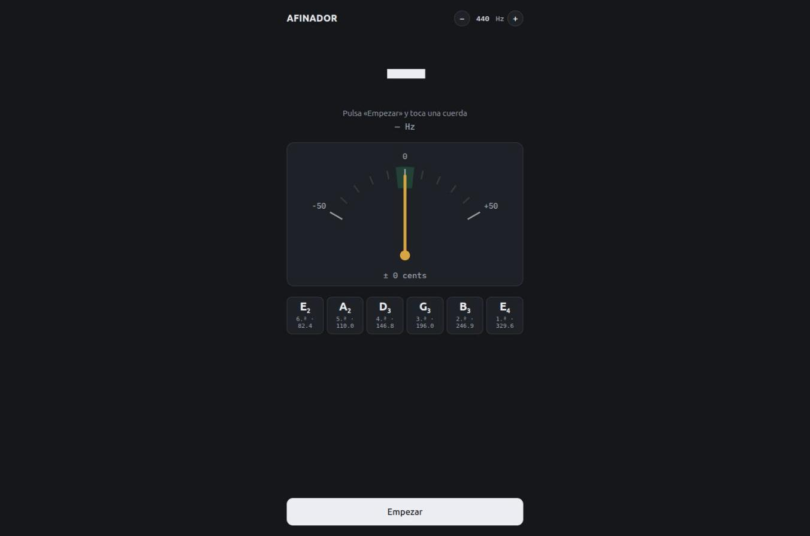

# afinador

Afinador web para guitarra, sin anuncios. Funciona en el navegador del móvil y se puede añadir a la pantalla de inicio de Android como si fuera una app.

**Úsalo aquí:** https://ertondev.github.io/afinador/



## Qué hace

- Detecta la nota que suena por el micrófono y muestra cuántos *cents* te desvías.
- Aguja de −50 a +50 cents con zona verde de ±5 cents (afinado).
- Resalta la cuerda más cercana de la afinación estándar: Mi2, La2, Re3, Sol3, Si3, Mi4.
- Te dice si tienes que tensar o aflojar la cuerda.
- Referencia del La4 ajustable entre 430 y 450 Hz (por defecto 440 Hz).
- Mantiene la pantalla encendida mientras afinas.
- Botón **Parar** que apaga el micrófono por completo cuando terminas.
- Tema claro y oscuro según el ajuste del móvil.

Todo está en un solo archivo, `index.html`, sin librerías ni servidor. El audio se procesa en tu propio móvil y no se envía a ningún sitio.

## Cómo instalarlo en Android

1. Abre https://ertondev.github.io/afinador/ en Chrome.
2. Pulsa **Empezar** y permite el acceso al micrófono.
3. Menú ⋮ → **Añadir a pantalla de inicio**.

## Cómo funciona

El código de `index.html` está comentado en cuatro bloques:

1. **Datos musicales.** Cada nota se representa con su número MIDI (La4 = 69). La conversión de frecuencia a nota es `69 + 12 · log₂(f / 440)`. La parte decimal, multiplicada por 100, son los cents de desviación.
2. **Detección del tono (algoritmo YIN).** Compara la señal consigo misma desplazada τ muestras. Cuando el desplazamiento coincide con el periodo de la onda, la diferencia es mínima, y la frecuencia es `muestras por segundo / τ`. Una normalización evita confundir la nota con su octava, y una interpolación parabólica da precisión por debajo de una muestra.
3. **Interfaz.** Dibuja el dial en SVG y suaviza las lecturas con la mediana de las últimas cinco para que la aguja no tiemble.
4. **Micrófono.** Usa la Web Audio API (`getUserMedia` + `AnalyserNode`) con la cancelación de eco y la supresión de ruido desactivadas, porque deforman la señal de un instrumento.

## Probarlo en local

El navegador solo permite usar el micrófono en `https://` o en `localhost`. Para probar cambios en el ordenador:

```bash
python3 -m http.server 8000
```

y abre http://localhost:8000.

## Ideas para seguir

- Afinaciones alternativas (Drop D, DADGAD, Open G).
- Modo para bajo o ukelele.
- Convertirlo en PWA completa con `manifest.json` e icono propio.

## Licencia

MIT. Consulta el archivo [LICENSE](LICENSE).
